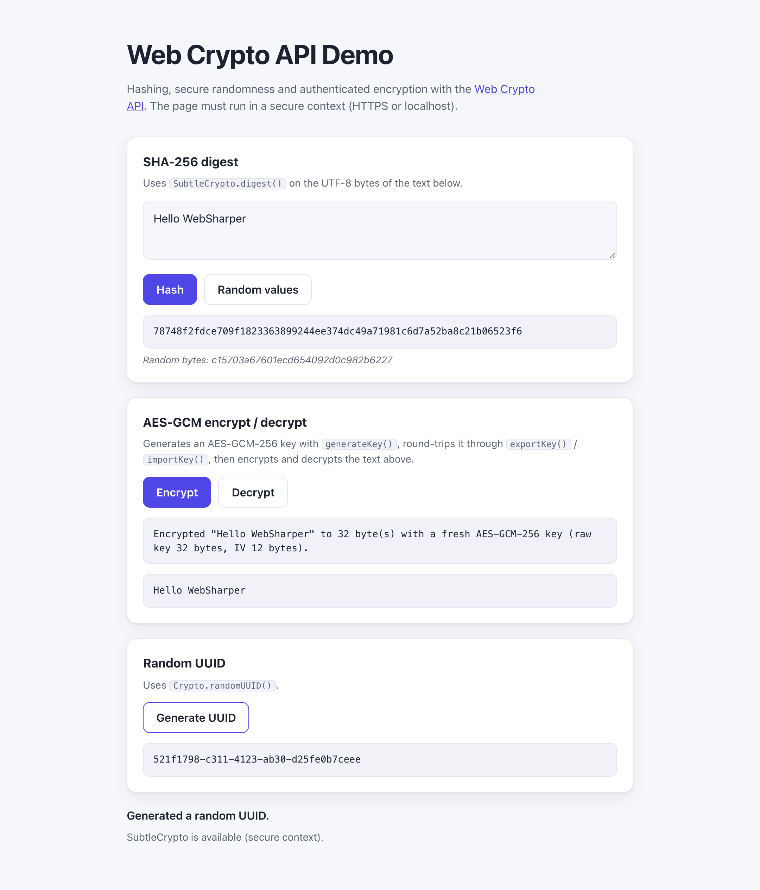

# WebSharper.WebCrypto

[](https://github.com/dotnet-websharper/WebCrypto)

WebSharper bindings for the [Web Crypto API](https://developer.mozilla.org/en-US/docs/Web/API/Web_Crypto_API) —
hashing, secure random values, key generation and authenticated encryption from F# and C# web apps.

`SubtleCrypto` is only available in [secure contexts](https://developer.mozilla.org/en-US/docs/Web/Security/Defenses/Secure_Contexts)
(HTTPS or localhost).

This repository contains:

| Project | Purpose |
| --- | --- |
| `WebSharper.WebCrypto` | The binding: WIG definitions for `Crypto`, `SubtleCrypto`, `CryptoKey`, `CryptoKeyPair`, `JsonWebKey`, and the algorithm parameter dictionaries (AES, EC/ECDH/ECDSA, HKDF, HMAC, PBKDF2, RSA-OAEP, RSA-PSS). |
| `WebSharper.WebCrypto.Extensions` | `[<Inline>]` accessors: `WindowCrypto()` (`window.crypto`) and `WorkerCrypto()` (`self.crypto`). |
| `WebSharper.WebCrypto.Sample` | An ASP.NET Core SPA that demonstrates SHA-256, AES-GCM encryption/decryption, random values and UUIDs. |

## Live demos

**Try it live:** [Open the sample in your browser](https://dotnet-websharper.github.io/WebCrypto/)



The sample doubles as the binding's [test case](#running-the-sample): it hashes text with `digest()`, generates and round-trips an AES-GCM-256 key with `generateKey()`/`exportKey()`/`importKey()`, encrypts and decrypts with `encrypt()`/`decrypt()`, and fills arrays with `getRandomValues()` and `randomUUID()`.

- **Sample (this repository):** <https://dotnet-websharper.github.io/WebCrypto/>
- **Source repository:** <https://github.com/dotnet-websharper/WebCrypto>
- **WebSharper bindings:** <https://websharper.com/bindings>

## Features

- `Crypto.randomUUID()`, `Crypto.getRandomValues()`, and `Crypto.subtle`.
- `SubtleCrypto.digest()`, `encrypt()`, `decrypt()`, `sign()`, `verify()`.
- `SubtleCrypto.generateKey()`, `deriveKey()`, `deriveBits()`, `importKey()`, `exportKey()`, `wrapKey()`, `unwrapKey()`.
- Algorithm dictionaries with correctly required/optional fields: `AesCbcParams`, `AesCtrParams`, `AesGcmParams`, `AesKeyGenParams`, `EcKeyGenParams`, `EcKeyImportParams`, `EcdhKeyDeriveParams`, `EcdsaParams`, `HkdfParams`, `HmacImportParams`, `HmacKeyGenParams`, `Pbkdf2Params`, `RsaHashedImportParams`, `RsaHashedKeyGenParams`, `RsaOaepParams`, `RsaPssParams`.
- `CryptoKey` (`type`, `extractable`, `algorithm`, `usages`), `CryptoKeyPair`, and `JsonWebKey`.
- `KeyUsages`, `KeyType`, and `Format` enums.

## Installation

The binding is not currently published to NuGet. Reference the projects from source:

```bash
git clone https://github.com/dotnet-websharper/WebCrypto.git
```

```xml
<ItemGroup>
  <ProjectReference Include="path/to/WebSharper.WebCrypto/WebSharper.WebCrypto.fsproj" />
  <ProjectReference Include="path/to/WebSharper.WebCrypto.Extensions/WebSharper.WebCrypto.Extensions.fsproj" />
</ItemGroup>
```

## Usage

```fsharp
namespace WebSharper.WebCrypto.Demo

open WebSharper
open WebSharper.JavaScript
open WebSharper.WebCrypto

[<JavaScript>]
module Demo =
    let crypto = WindowCrypto()

    let strToBuf (s: string) : Uint8Array =
        let enc : obj = JS.Eval "new TextEncoder()"
        enc?encode(s) |> As<Uint8Array>

    let toHex (buffer: ArrayBuffer) : string =
        let bytes = Uint8Array(buffer)
        Seq.init bytes.Length (fun i -> bytes.Get(i))
        |> Seq.map (fun b -> sprintf "%02x" b)
        |> String.concat ""

    let sha256 (text: string) =
        promise {
            let! digest = crypto.Subtle.Digest("SHA-256", strToBuf text)
            return toHex digest
        }

    let encryptAndDecrypt (text: string) =
        promise {
            let usages = [| KeyUsages.Encrypt; KeyUsages.Decrypt |]

            // generateKey() returns a CryptoKey for symmetric algorithms.
            let! generated =
                crypto.Subtle.GenerateKey(
                    AesKeyGenParams(name = "AES-GCM", length = 256),
                    true,
                    usages)
            let key = generated |> As<CryptoKey>

            // exportKey()/importKey() round-trip the raw key bytes.
            let! rawKey = crypto.Subtle.ExportKey(Format.Raw, key)
            let! imported =
                crypto.Subtle.ImportKey(
                    Format.Raw,
                    rawKey |> As<ArrayBuffer>,
                    AesKeyGenParams(name = "AES-GCM", length = 256),
                    true,
                    usages)
            let importedKey = imported |> As<CryptoKey>

            let iv = crypto.GetRandomValues(Uint8Array(12)) |> As<Uint8Array>
            let! encrypted =
                crypto.Subtle.Encrypt(
                    AesGcmParams(name = "AES-GCM", iv = iv),
                    importedKey,
                    strToBuf text)
            let! plain =
                crypto.Subtle.Decrypt(
                    AesGcmParams(name = "AES-GCM", iv = iv),
                    importedKey,
                    encrypted)
            return (Uint8Array(encrypted).Length, plain)
        }

    let newUuid () = crypto.RandomUUID()
```

Note that `generateKey()`, `importKey()`, `exportKey()` and `unwrapKey()` can return either a `CryptoKey` or a `CryptoKeyPair` (for asymmetric algorithms), so the binding types their result as `Promise<obj>`; cast it to the shape you expect (`As<CryptoKey>` or `As<CryptoKeyPair>`).

## Running the sample

Build the sample in Release and serve its static output:

```bash
dotnet build WebSharper.WebCrypto.Sample/WebSharper.WebCrypto.Sample.fsproj -c Release
python3 -m http.server -d WebSharper.WebCrypto.Sample/wwwroot 5615
```

Open <http://localhost:5615/>. Localhost counts as a secure context, so `SubtleCrypto` is available.

Alternatively, run the ASP.NET Core host:

```bash
dotnet run --project WebSharper.WebCrypto.Sample
```

## Building from source

### Prerequisites

- [.NET SDK 10](https://dotnet.microsoft.com/download) or later.

### Build

```bash
dotnet tool restore
dotnet paket install
dotnet build WebSharper.WebCrypto.sln -c Release
```

The binding projects target `netstandard2.0`; the sample targets `net10.0`.

## Deployment

Pushing to `main` triggers `.github/workflows/ghpages.yml`, which builds the sample in Release and publishes
`WebSharper.WebCrypto.Sample/wwwroot` to the `gh-pages` branch.

## Repository layout

```
WebSharper.WebCrypto/              # binding (WIG definitions)
  Main.fs
WebSharper.WebCrypto.Extensions/   # [<Inline>] client extensions
  Library.fs
WebSharper.WebCrypto.Sample/       # ASP.NET Core SPA demo
  Client.fs
  Startup.fs
  wwwroot/
    index.html
    site.css
docs/sample.png                    # screenshot used in this README
.github/workflows/ghpages.yml      # build + deploy the sample to GitHub Pages
```

## Notes on the API

- **Secure context:** `crypto.subtle` is only exposed in secure contexts. Serve the page over HTTPS or from localhost.
- **Accessing the `Crypto` object:** core `WebSharper.JavaScript` already exposes a `Window.Crypto` property typed as `obj`, so this binding provides the `WindowCrypto()` and `WorkerCrypto()` module functions instead of a shadowed extension member.
- **Required algorithm fields:** the algorithm dictionaries follow the spec — for example `AesGcmParams` requires `name` and `iv`, while `additionalData` and `tagLength` are optional. Required fields are constructor arguments; optional fields are settable properties.
- **Union results:** `generateKey()`, `importKey()`, `exportKey()` and `unwrapKey()` are typed as `Promise<obj>` because their result is a union (`CryptoKey`, `CryptoKeyPair`, `ArrayBuffer` or `JsonWebKey`); cast with `As<...>`.
- **`getRandomValues()`:** the spec limits a single call to 65,536 bytes, and it must not be used to generate key material — use `generateKey()` for that.

## License

Apache 2.0 — see [LICENSE.md](LICENSE.md).
